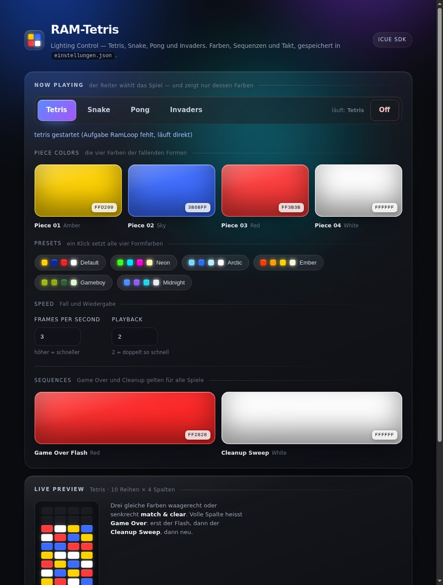
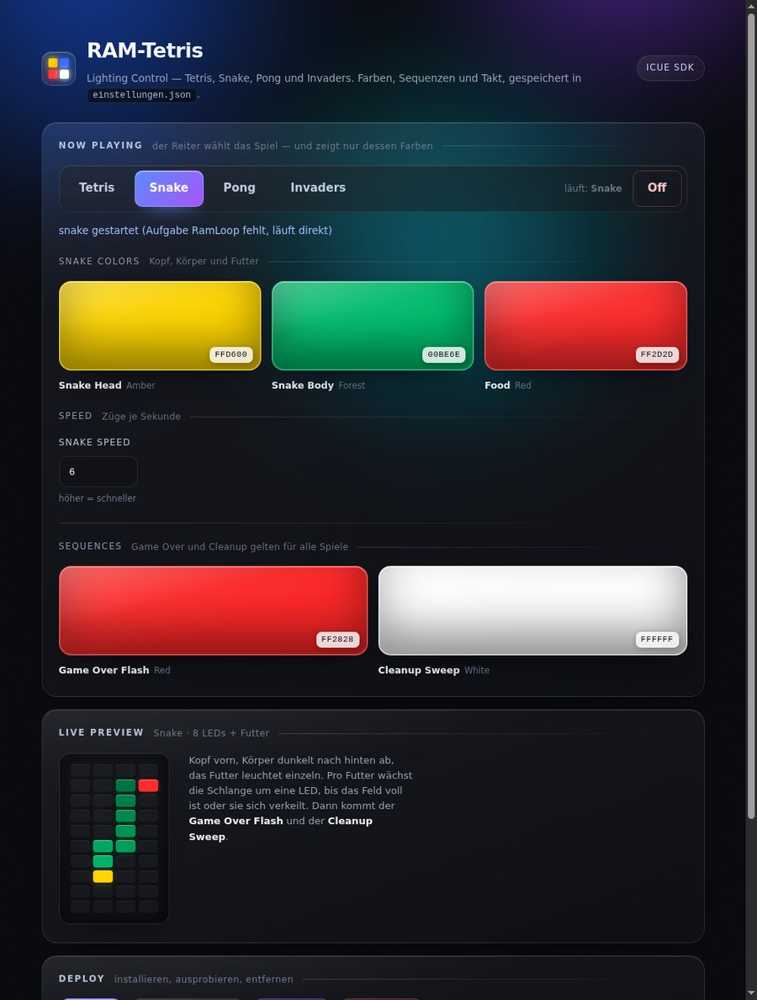
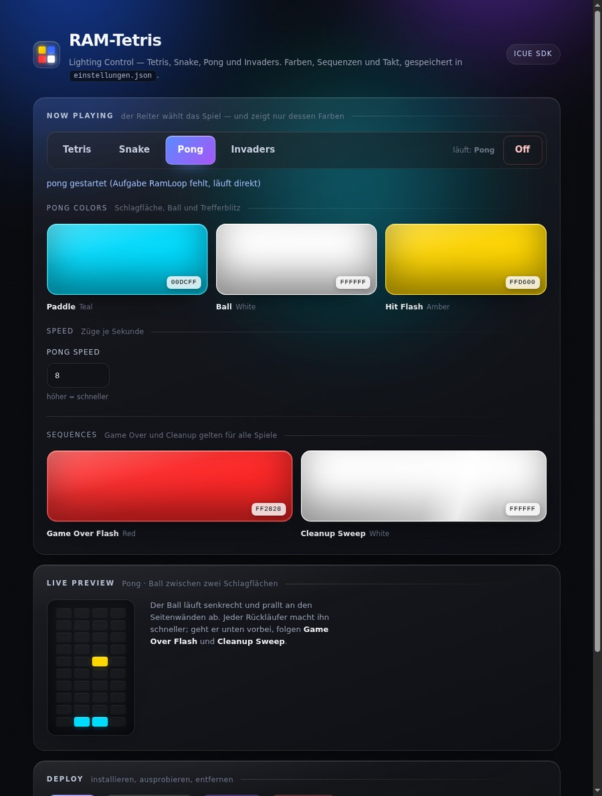
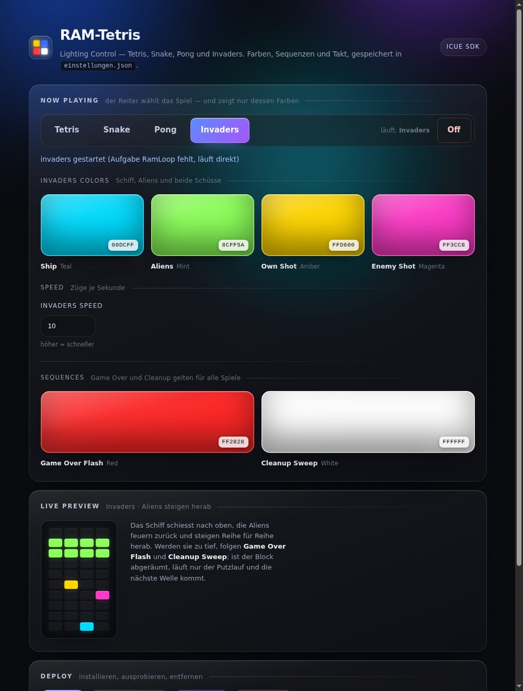

# RAM Games — Guide

Four games for the RGB LEDs on your memory modules: **Tetris**, **Snake**, **Pong** and
**Space Invaders**. They run on the iCUE SDK that ships with your Corsair installation, so there is
nothing to install and no extra driver.

*Deutsche Fassung weiter unten: [Anleitung (Deutsch)](#anleitung-deutsch).*



---

## 1. What you need

| What | Why | Where from |
|---|---|---|
| **iCUE** (Corsair) | drives the hardware; the script only sets colours | corsair.com, iCUE 5 |
| **iCUESDK DLL** | the interface that sets colours | usually already on disk: Gigabyte Control Center, MSI Center, ASUS Armoury — or iCUE itself |
| **Python 3.9 or newer** | runs the games | python.org, tick "Add Python to PATH" |
| Corsair Vengeance RGB memory | that is what the games draw on | — |

**iCUE must be installed and running.** This is the one hard requirement: the games do not talk to
the memory modules themselves, they only set colours through iCUE's SDK. Without iCUE the modules
keep whatever iCUE last did — nothing to see, no error on the LEDs. If iCUE is running but its SDK
control is switched off, the script reports error 1 on startup.

You do **not** need OpenRGB and you do not need a compiler. If Python is missing, the interpreter
that comes with Blender works too (`…\Blender Foundation\Blender <ver>\<ver>\python\bin\python.exe`).

### Is that DLL Gigabyte-specific? No.

It is **Corsair's own cue-sdk**; the `_2019` suffix is the SDK-4 ABI, and Gigabyte (or MSI, ASUS)
only ship it alongside their tools. Measured on the reference machine, the exports are the SDK-4
set — `CorsairConnect`, `CorsairGetDevices`, `CorsairGetLedPositions`, and *no*
`CorsairPerformProtocolHandshake` or `CorsairGetDeviceCount`, which are the SDK-3 API. So it is not
a vendor build, and it runs on other Windows machines with these conditions:

| Condition | Why | Symptom if it fails |
|---|---|---|
| **iCUE 4/5 installed and running** | the DLL is only a client to the iCUE service, it does not talk to hardware itself | error 1 "not connected" |
| DLL and iCUE from the same generation | the protocol between DLL and service is versioned | error 3 "protocol incompatible" |
| bitness matches Python | 64-bit interpreter needs the `x64` DLL | the DLL does not load at all |
| Visual C++ runtime present | the DLL depends on it | the DLL does not load |

The script finds the DLL by itself: `ICUESDK_DLL` (environment variable, wins) → known install
paths (Corsair, Gigabyte, MSI, ASUS) → bounded search of both `Program Files` folders, preferring
the bitness that matches the interpreter.

**Do not copy the DLL into a repository or hand it to other people.** It is Corsair's file; let each
machine bring its own. That is also why this project ships no DLL.

## 2. First run

```
python ram_tetris.py --probe      # which device, how many LEDs, which grid
python snake.py --simulate        # snake as ASCII in the terminal, no LEDs
python pong.py                    # pong on the LEDs
```

`--probe` should report something like `VENGEANCE RGB PRO · 40 LEDs · 4 channels` and
`10 rows × 4 columns`. If it says the SDK DLL is missing, see section 12.

Nothing is written to the registry and nothing is installed. While a game runs, the script holds
exclusive control of the modules; when it exits, iCUE takes over again.

## 3. The settings page

Double-click **`einstellungen.cmd`** in the project folder (or the desktop shortcut
*RAM-Tetris Einstellungen*). It starts a local server, waits for it to answer and opens the page in
your browser. If the server is already running, it only opens the browser — **you never have to
remember a port**.

Manually: `python einstellungen.py`, then `http://127.0.0.1:8787/` (port can be changed with
`RAMTETRIS_PORT`).

The page is a single control: the tabs at the top choose **which game runs** and at the same time
show **only that game's colours**.

| Tab | What it does |
|---|---|
| **Tetris** | starts Tetris, shows Piece 01–04, presets, frames per second and playback speed |
| **Snake** | starts Snake, shows head, body, food and moves per second |
| **Pong** | starts Pong, shows paddle, ball, hit flash and moves per second |
| **Invaders** | starts Space Invaders, shows ship, aliens, both shots and moves per second |
| **Off** | stops everything; the last open palette stays visible so you can keep editing |

**Game Over Flash** and **Cleanup Sweep** sit below all tabs, because they apply to every game —
they are stored once, not once per game.

The **Live Preview** follows the tab and shows the real 10 × 4 geometry with your colours.

| | |
|---|---|
|  |  |
|  | |

## 4. The four games

**Tetris.** Shapes fall from above into four columns. Three equal colours in a row or a column
match and clear, the rest slides down. When one column reaches the top, everything flashes red and
white waves wipe the board.

**Snake.** Grows by one LED with every bite, until the board is full or it traps itself, then red
flash and cleanup wipe. It plays itself — nobody can reach the memory modules while the machine is
running. The autopilot is a small search: never into wall or body, keep the food reachable, prefer
the move with the most free space, and among those the one closest to the food.

**Pong.** The ball runs vertically, bounces off the side walls, a two-LED paddle waits at the
bottom. Every return makes the ball faster. If it passes the paddle, red flash and cleanup.

**Space Invaders.** Two rows of aliens descend one row at a time; the ship at the bottom shoots
upwards and dodges incoming shots. Ship hit or aliens at the bottom → red flash and cleanup. Clear
the block and only the **cleanup sweep** runs, then the next, faster wave.

## 5. Colours and speed

Everything is stored in `einstellungen.json` and read at start — either through the page or by
editing the file:

```json
{
 "palette":  [[255,210,0], [59,107,255], [255,59,59], [255,255,255]],
 "verloren": [255,40,40],
 "welle":    [255,255,255],
 "fps": 3, "speed": 2,
 "snake":    {"kopf": [255,214,0], "koerper": [0,190,110], "futter": [255,45,45], "fps": 6},
 "pong":     {"schlaeger": [0,220,255], "ball": [255,255,255], "treffer": [255,214,0], "fps": 8},
 "invaders": {"schiff": [0,220,255], "alien": [140,255,90], "schuss": [255,214,0],
              "alien_schuss": [255,60,200], "fps": 10},
 "modus": "tetris"
}
```

Colours are three numbers 0–255 (red, green, blue). `verloren` and `welle` are shared by all
games. `modus` is what runs: `tetris`, `snake`, `pong`, `invaders` or `aus` (off).

The repository carries **`einstellungen.beispiel.json`** with exactly these defaults — copy it to
`einstellungen.json` to start from them. If the file is missing, every game falls back to the same
values, so nothing breaks; the settings page writes the file on the first **Save**.

Only one game runs at a time — they all write to the same 40 LEDs.

## 6. Autostart: Deploy and Remove

| Button | Effect |
|---|---|
| **Save** | writes `einstellungen.json`; the running game picks it up on its next start |
| **Preview Run** | short trial run of the selected game in its own window |
| **Deploy** | writes `start.cmd`, puts a shortcut in your Startup folder and starts the game |
| **Remove** | deletes both and stops the game; iCUE controls the modules again |

The Startup shortcut carries the project's own icon (`ram-tetris.ico`).

**What runs after a reboot.** The last game you selected is remembered: the tab writes `modus` into
`einstellungen.json`, and the supervisor reads it on every start. `Deploy` registers a scheduled
task named `RamLoop` that fires **at logon with a 30 second delay** — iCUE has to be up before the
SDK can connect, and the supervisor retries until it is. `Remove` deletes the task and sets
`modus` to `aus`, so nothing comes back after a reboot.

**No console window, from either route.** The task runs `wscript.exe run_hidden.vbs`; the desktop
shortcut runs `wscript.exe einstellungen_hidden.vbs`, which starts PowerShell with
`-WindowStyle Hidden`. Errors from the settings page cannot be printed anywhere, so they show up as
a message box and are appended to `%TEMP%\ram-games-einstellungen.log`.

**Only one settings server.** On Windows `SO_REUSEADDR` (which `HTTPServer` sets) lets two sockets
bind the same port, so two settings pages can run side by side and silently serve different
configuration. The script therefore probes the port first and exits if something already answers.

**What runs after a reboot.** The last game you selected is remembered: the tab writes `modus` into
`einstellungen.json`, and the supervisor reads it on every start. `Deploy` registers a scheduled
task named `RamLoop` that fires **at logon with a 30 second delay** — iCUE has to be up before the
SDK can connect, and the supervisor retries until it is. `Remove` deletes the task and sets
`modus` to `aus`, so nothing comes back after a reboot.

**No console window, from either route.** The task runs `wscript.exe run_hidden.vbs`; the desktop
shortcut runs `wscript.exe einstellungen_hidden.vbs`, which starts PowerShell with
`-WindowStyle Hidden`. Errors from the settings page cannot be printed anywhere, so they show up as
a message box and are appended to `%TEMP%\ram-games-einstellungen.log`.

**Only one settings server.** On Windows `SO_REUSEADDR` (which `HTTPServer` sets) lets two sockets
bind the same port, so two settings pages can run side by side and silently serve different
configuration. The script therefore probes the port first and exits if something already answers.

## 7. Recording a run and looping it (Tetris)

```
python ram_tetris.py --record recorded\run.json --runden 1 --fps 3
python ram_tetris.py --replay recorded\run.json --loop --speed 2
```

Recording ends after a **completed round**, so the losing sequence is inside the file. A recording
replays deterministically — which is the honest answer to "can this be an iCUE profile?" No: iCUE
profiles have no timeline. But a loop in your own script does the job.

## 8. When the picture freezes: logs, supervisor, no window

The supervisor `spielen.py` starts the selected game as a child process and watches it:

| File | Contents |
|---|---|
| `ram-log.txt` | start, exit code, LED write errors, watchdog restarts |
| `ram-ausgabe.txt` | everything the game printed (crash traces) |

If the game dies, it is restarted after a few seconds (up to 50 attempts). A file lock makes sure
two supervisors never run side by side — both would write to the same LEDs.

Inside the game: 25 seconds without a successful LED write, or 40 failed frames in a row, and it
ends itself so the supervisor can start a fresh process with a fresh SDK session. That is the honest
way out when iCUE takes control back; tearing the session down inside a running process crashes the
DLL with an access violation.

The scheduled task starts `wscript.exe` with `run_hidden.vbs`, so **no console window** appears.
Verified: every process in the chain reports window handle 0.

## 9. Adding your own game

Four places, no more:

1. a script that uses `spielbasis.py` (`schreibe_bild`, `verloren_und_putzen`, `watchdog_starten`),
2. an entry in `SPIELE` in `spielen.py`,
3. a tab plus colour block in `einstellungen.py`,
4. the name in the mode check of `_spiel_umschalten` **and** in `SPIEL_MUSTER` — otherwise the game
   starts but `Off` does not stop it, and the supervisor pulls it back up.

The shared sequence (`Game Over Flash`, `Cleanup Sweep`) comes for free: it lives in
`spielbasis.py` and reads the shared colours from the configuration.

## 10. Troubleshooting

| Symptom | Cause | Fix |
|---|---|---|
| "sdk dll not found" | no iCUESDK DLL on the machine | install Gigabyte Control Center / MSI Center / ASUS Armoury, or copy the DLL next to the script |
| "not connected" / error 1 | iCUE is not running, or SDK control is disabled in iCUE | start iCUE, enable SDK in the iCUE settings |
| error 2 / picture freezes | another client took control | the game re-requests control and restarts itself; do not run two games at once |
| LEDs stay dark although the script runs | another program holds the devices, or brightness is 0 in iCUE | quit the other program, check iCUE brightness |
| only two of four columns light up | the modules report four channels but only two are populated | cosmetic, the game still plays |
| nothing happens after a double click on `einstellungen.cmd` | Python not found (the `python.exe` stub in `WindowsApps` only opens the Microsoft Store) | install Python, or use the Blender interpreter |
| the console window appears in the foreground | the task starts `cmd` directly | use the bundled `run_hidden.vbs` (wscript has no console) |
| old icon still shown after a change | Explorer icon cache | `ie4uinit.exe -show`, then F5 on the desktop |

Log first, guess second: `ram-log.txt` tells you whether the game crashed, was restarted or could
not write.

## 11. The program icon

`mache_icon.py` builds `ram-tetris.ico` without any extra library: four colour tiles on a dark,
rounded background, seven sizes from 16 to 256 px, written as 32-bit BMP with an AND mask.

```
python mache_icon.py              # writes ram-tetris.ico
python mache_icon.py --vorschau   # also writes a PNG preview
```

To match your own palette, replace the four triplets in `KACHELN` at the top of the script and run
it again. Deploy sets `IconLocation` on the shortcut automatically.

## 12. Licence

MIT. Model for this project was the short "Mein RAM spielt Tetris, ganz ohne mich" by **Bastel
Nerd** — his own program, not an iCUE effect.

---
---

# Anleitung (Deutsch)

Diese Anleitung führt vom leeren Rechner bis zum laufenden Spiel und zeigt, wie man Farben,
Tempo und Ablauf ändert. Alles ohne Programmieren.

## 1. Was vorhanden sein muss

| Was | Warum | Woher |
|---|---|---|
| **iCUE** (Corsair) | steuert die Hardware, das Skript setzt nur Farben | corsair.com, iCUE 5 |
| **iCUESDK-DLL** | die Schnittstelle, über die Farben gesetzt werden | kommt meist schon mit: Gigabyte Control Center, MSI Center, ASUS Armoury — oder iCUE selbst |
| **Python 3.9 oder neuer** | führt das Spiel aus | python.org, „Add Python to PATH" anhaken |
| Corsair-RAM **mit RGB** | das Spielfeld | z. B. Vengeance RGB Pro / Pro SL |

**iCUE muss installiert und gestartet sein.** Das ist die einzige harte Voraussetzung: die Spiele
sprechen nicht selbst mit den Riegeln, sie setzen Farben über die SDK von iCUE. Ohne iCUE bleiben die
Riegel bei dem, was iCUE zuletzt gemacht hat — man sieht nichts, und auf den LEDs steht auch keine
Fehlermeldung. Läuft iCUE, ist dort aber die SDK-Steuerung abgeschaltet, meldet das Skript beim Start
Fehler 1.

Die DLL sucht das Skript selbst:

```
C:\Program Files\GIGABYTE\Control Center\Lib\MBStorage\iCUESDK.x64_2019.dll
C:\Program Files (x86)\GIGABYTE\Control Center\Lib\MBStorage\iCUESDK.x64_2019.dll
C:\Program Files\Corsair\Corsair iCUE5 Software\iCUESDK.x64_2019.dll
```

Fehlt sie überall, sagt das Skript das beim Start — dann fehlt der Mainboard-Hersteller-Software
die SDK-Komponente, oder man besorgt sie über Corsairs SDK-Seite.

### Ist die DLL Gigabyte-spezifisch? Nein.

Es ist **Corsairs eigene cue-sdk**; die Jahreszahl `_2019` steht für die SDK-4-Schnittstelle, Gigabyte
(oder MSI, ASUS) liefert sie nur mit. Auf dem Referenzrechner gemessen bietet die DLL genau den
SDK-4-Satz: `CorsairConnect`, `CorsairGetDevices`, `CorsairGetLedPositions` — und **kein**
`CorsairPerformProtocolHandshake` und **kein** `CorsairGetDeviceCount`, das wäre die ältere SDK-3-API.
Sie ist also kein Hersteller-Build und läuft auf anderen Windows-Rechnern unter diesen Bedingungen:

| Bedingung | Warum | Symptom, wenn es fehlt |
|---|---|---|
| **iCUE 4/5 installiert und gestartet** | die DLL ist nur ein Client des iCUE-Dienstes, sie spricht nicht selbst mit der Hardware | Fehler 1 „nicht verbunden" |
| DLL und iCUE aus derselben Generation | das Protokoll zwischen DLL und Dienst ist versioniert | Fehler 3 „Protokoll unvereinbar" |
| Bitbreite passt zu Python | 64-Bit-Interpreter braucht die `x64`-DLL | die DLL lädt gar nicht |
| Visual-C++-Runtime vorhanden | die DLL hängt davon ab | die DLL lädt gar nicht |

Gesucht wird in dieser Reihenfolge: `ICUESDK_DLL` (Umgebungsvariable, gewinnt) → bekannte
Installationsorte (Corsair, Gigabyte, MSI, ASUS) → begrenzte Suche in beiden `Program Files`-Ordnern,
mit Vorliebe für die Bitbreite des Interpreters.

**Die DLL nicht ins Repository legen und nicht weitergeben.** Sie ist Corsairs Datei; jeder Rechner
soll seine eigene mitbringen. Deshalb liegt in diesem Projekt keine.

## 2. Erster Start: prüfen, ob das Feld erkannt wird

Im Ordner des Spiels eine Eingabeaufforderung öffnen (Shift + Rechtsklick → „Terminal hier öffnen")
und:

```
python ram_tetris.py --probe
```

Erwartete Ausgabe:

```
Kontrolle: Erfolg
VENGEANCE RGB PRO: 10 Reihen × 4 Spalten (40 LEDs adressierbar)
```

Erscheint statt des RAM ein anderes Gerät, den Namen mit `--muster` setzen:
`--muster "VENGEANCE"`. Wird gar kein Gerät gefunden, läuft iCUE nicht — dann iCUE starten.

## 3. Spielen

```
python ram_tetris.py --play
```

Beenden mit `Strg + C`. Danach übernimmt iCUE die Beleuchtung wieder.

Ohne Hardware testen (zeigt das Spielfeld im Terminal):

```
python ram_tetris.py --simulate --steine 60
```

## 4. Farben ändern

**Der einfache Weg** — Farben als Hex-Werte, mit Komma getrennt:

```
python ram_tetris.py --play --palette FFD200,0A28AA,FF1E1E,FFFFFF
```

Das sind Gelb, Dunkelblau, Rot und Weiß (die Vorgabe). Beliebige eigene Werte gehen genauso:
`--palette 00FF88,FF00AA` ergibt zwei Farben, `--palette 111111,222222,333333,444444,555555` fünf.
Mindestens zwei, höchstens so viele, wie das Feld sinnvoll verkraftet — bei vielen Farben entstehen
seltener Ketten.
Alle Farben, Tempi und das gewählte Spiel stehen in `einstellungen.json`; im Repository liegt
**`einstellungen.beispiel.json`** mit genau den Vorgaben — kopieren nach `einstellungen.json`, um
damit zu starten. Fehlt die Datei, greifen dieselben Werte als Vorgabe; die Einstellungsseite
schreibt sie beim ersten **Save**.


**Der dauerhafte Weg** — im Einstellungsfenster speichern (Abschnitt 5) oder die Farbe in der Datei
`start.cmd` ändern (Abschnitt 8), damit man den Befehl nicht jedes Mal tippen muss.

Farbnamen für Hex-Werte findet man überall im Netz („color picker"). Die Reihenfolge der Liste ist
egal, sie bestimmt nur, welche Farbe im Terminal als A, B, C… erscheint.


## 5. Das Einstellungsfenster (empfohlen)

Kein Befehl, kein Port zum Merken: im Projektordner liegt **`einstellungen.cmd`** — ein Doppelklick
genügt. Der Starter prüft, ob der lokale Server schon läuft; wenn ja, öffnet er nur den Browser, wenn
nein, startet er ihn und öffnet dann die Seite. Auf Wunsch eine Verknüpfung auf den Desktop legen
(Rechtsklick → Senden an → Desktop).

Dort einstellen:

- **Piece Colors** — die vier Farben der fallenden Formen (große Flächen, Klick öffnet den Farbwähler)
- **Game Over Flash** — die Farbe, in der es blinkt, wenn eine Leiste voll ist
- **Cleanup Sweep** — die Farbe der Wellen, die danach durchlaufen
- **Speed** — Bilder je Sekunde und Wiedergabe-Tempo
- **Presets** — sechs fertige Paletten zum Antippen

Knöpfe: **Save** · **Preview Run** · **Deploy** · **Remove**

| Knopf | Wirkung |
|---|---|
| **Save** | schreibt `einstellungen.json`; das Spiel liest sie beim nächsten Start |
| **Preview Run** | startet einen Probelauf mit den aktuellen Farben |
| **Deploy** | legt `start.cmd` an, setzt eine Verknüpfung in den Autostart und startet das Spiel |
| **Remove** | nimmt Autostart und `start.cmd` zurück und beendet das Spiel |

Von Hand geht es auch: `python einstellungen.py` und dann `http://127.0.0.1:8787/` aufrufen. Warum im
Browser und nicht als klassisches Fenster: Blenders Python — der Interpreter, den dieses Projekt
mitbenutzt — bringt Tkinter nicht mit, und große Farbflächen mit dem System-Farbwähler bekommt man im
Browser ohnehin leichter.

## 6. Tempo ändern

| Was | Schalter | Wirkung |
|---|---|---|
| Fallgeschwindigkeit | `--fps 6` | Bilder je Sekunde; größer = schneller |
| Wiedergabe einer Aufnahme | `--speed 2` | 2 = doppelt so schnell, 0.5 = halb so schnell |

## 7. Aufnehmen und als Schleife laufen lassen

Einmal live spielen und dabei aufnehmen — danach läuft dieselbe Runde endlos, ohne Zufall:

```
python ram_tetris.py --record recorded\meinelauf.json --runden 1 --fps 3
python ram_tetris.py --replay recorded\meinelauf.json --loop --speed 2
```

`--runden 1` nimmt genau eine Runde auf, inklusive Verloren-Blinken und Putz-Wellen. Die Wiedergabe
ist deterministisch: gleiche Aufnahme, gleicher Ablauf, immer wieder.

## 8. Automatisch starten (optional)

`start.cmd` im Spielordner anlegen:

```bat
@echo off
cd /d "%~dp0"
python ram_tetris.py --replay recorded\meinelauf.json --loop --speed 2
```

Danach läuft es bei jeder Anmeldung — ohne zusätzliche Software.

**Was nach einem Neustart läuft.** Das zuletzt gewählte Spiel ist gemerkt: der Reiter schreibt
`modus` in `einstellungen.json`, und der Starter liest ihn bei jedem Start. **Deploy** legt dafür
die geplante Aufgabe `RamLoop` an, die **bei der Anmeldung mit 30 Sekunden Verzögerung** startet —
iCUE muss vorher laufen, sonst kommt keine SDK-Verbindung zustande; der Starter versucht es so lange
erneut, bis es klappt. **Remove** löscht die Aufgabe und setzt `modus` auf `aus`, damit nach einem
Neustart nichts von selbst hochkommt.

**Kein Konsolenfenster, auf keinem der beiden Wege.** Die Aufgabe ruft
`wscript.exe run_hidden.vbs`; die Desktop-Verknüpfung ruft `wscript.exe einstellungen_hidden.vbs`,
und das startet PowerShell mit `-WindowStyle Hidden`. Weil ein verstecktes Fenster nichts anzeigen
kann, erscheinen Fehler der Einstellungsseite als Meldungsfenster und landen zusätzlich in
`%TEMP%\ram-games-einstellungen.log`.

**Nur ein Einstellungs-Server.** Unter Windows erlaubt `SO_REUSEADDR` (das `HTTPServer` setzt) zwei
Bindungen auf denselben Port — dann laufen zwei Einstellungsseiten nebeneinander und liefern
abwechselnd verschiedene Einstellungen. Das Skript prüft den Port deshalb vorher und beendet sich,
wenn dort schon etwas antwortet.

## 9. Wenn etwas nicht geht

| Symptom | Ursache | Lösung |
|---|---|---|
| `iCUE-SDK-DLL nicht gefunden` | keine SDK-DLL auf dem Rechner | Abschnitt 1, Pfade prüfen |
| `iCUE-SDK nicht verbunden` | iCUE läuft nicht | iCUE starten, dann erneut |
| `Kein Gerät 'VENGEANCE' vom Typ 0x80 gefunden` | anderer Modellname | `--probe` zeigt die echten Namen, dann `--muster` anpassen |
| Riegel leuchten nicht, Spiel läuft | iCUE hat die Kontrolle behalten | `--probe` zeigt „Kontrolle: Erfolg"; sonst iCUE neu starten |
| nur ein Teil der Spalten leuchtet | iCUE meldet mehr Kanäle als Riegel gesteckt sind | normal, das Spiel läuft auf allen gemeldeten Kanälen |
| `python` wird nicht gefunden | Python nicht im PATH | Python neu installieren, „Add to PATH" anhaken |

## 10. Was das Spiel macht

Formen (O, I2, I3, L, J, S, T) fallen von oben in die Spalten. Drei gleiche Farben waagerecht oder
senkrecht verschwinden, der Rest rutscht nach. Ist eine Leiste bis oben zugebaut, ist die Runde
verloren: alles blinkt rot, danach wischen drei weiße Wellen das Feld sauber (senkrecht, dann
waagerecht hin und zurück), und es geht von vorn los.

## 11. Snake — das zweite Spiel

Dasselbe Feld, dieselbe Technik, andere Logik: statt fallender Steine eine Schlange, die sich
selbst spielt. Bedienung gibt es keine — es gibt keine Tastatur am RAM.

```
snake.cmd                  Doppelklick: spielt los (Strg+C beendet)
snake.cmd --fps 8          schneller
snake.cmd --sekunden 60    nach einer Minute aufhören
snake.cmd --probe          zeigt nur, was die Hardware meldet
python snake.py --simulate nur ASCII im Terminal, ohne LEDs
```

**Warum spielt es sich selbst?** Weil man an den RAM-Riegeln nicht herankommt, während der Rechner
läuft. Der Autopilot würfelt nicht, sondern sucht:

1. nur Züge, die nicht in die Wand oder in den eigenen Körper führen,
2. davon die, nach denen das Futter noch erreichbar bleibt,
3. unter denen den Zug mit dem meisten freien Platz (Flutfüllung) — sonst sperrt sich die Schlange
   in der schmalen 4-Spalten-Ecke selbst ein,
4. bei Gleichstand: der Zug, der näher ans Futter führt.

Über 4.000 Züge gemessen: bis zu 28 von 40 LEDs Länge, gelegentliche Tode, danach Neustart.

**Farben** stehen in `einstellungen.json` unter `snake`:

```json
"snake": {"kopf": [255, 214, 0], "koerper": [0, 190, 110],
          "futter": [255, 45, 45], "tod": [255, 20, 20]}
```

Fehlt der Block, gelten die Vorgaben; der Verlorenton wird dann aus `verloren` übernommen.

## 12. Spiel wählen, Snake-Farben — alles im Dashboard

Seit dem Umbau gibt es **einen** Starter und **einen** Ort für die Einstellungen. Die Karte
**Now Playing** oben im Dashboard schaltet um:

| Knopf | Wirkung |
|---|---|
| **Tetris** | beendet Snake, startet die Endlosschleife von Tetris |
| **Snake** | beendet Tetris, startet Snake (spielt sich selbst) |
| **Off** | beendet beides, iCUE steuert die Riegel wieder |

Immer nur eins — beide Spiele schreiben auf dieselben 40 LEDs.

Die Karte **Snake** setzt die Farben für **Kopf**, **Körper** und **Futter** sowie die Züge je
Sekunde. **Verloren-Blitz** und **Cleanup Sweep** stehen bei den **Sequences** und gelten für beide
Spiele; Snake nutzt also denselben roten Verloren-Screen und denselben weissen Putzlauf wie Tetris.

Gespeichert wird in `einstellungen.json`:

```json
"snake": {"kopf": [255,214,0], "koerper": [0,190,110], "futter": [255,45,45], "fps": 6},
"modus": "snake"
```

**Wie das Umschalten funktioniert:** die Windows-Aufgabe `RamLoop` ruft `run.cmd` auf, das
`spielen.py` startet. `spielen.py` liest `einstellungen.json` und startet danach das passende
Spiel. Deshalb hat die Aufgabe eine feste Kommandozeile und muss beim Umschalten nur neu gestartet
werden — Farben und Tempo gelten ab dem nächsten Start.

## 13. Wenn das Bild steht: Protokoll, Aufsicht, fensterloser Start

**Warum das Bild einfrieren konnte:** das SDK bietet zwei Wege, LEDs zu setzen — synchron
(`CorsairSetLedColors`) und über einen Puffer mit asynchronem Flush
(`CorsairSetLedColorsBuffer` + `CorsairSetLedColorsFlushBufferAsync`). Der Puffer-Weg räumt
nebenläufig auf und griff dabei auf bereits freigegebenen Speicher zu: der Prozess starb mit
`0xC0000005`, die LEDs blieben beim letzten Bild stehen. Von außen sieht das wie ein Hänger aus,
der Prozess ist aber tot. **Es wird jetzt immer synchron geschrieben** (`icue_sdk.py`,
`setze_farben_raw`) — einen Hauch langsamer, dafür stabil.

**Aufsicht.** `RamLoop` startet `run_hidden.vbs` → `run.cmd` → `spielen.py`. `spielen.py` liest
`einstellungen.json`, startet das gewählte Spiel als Kindprozess und passt auf:

| Datei | Inhalt |
|---|---|
| `ram-log.txt` | Start, Ende mit Rückgabewert, LED-Schreibfehler, Watchdogs |
| `ram-ausgabe.txt` | alles, was das Spiel auf die Konsole schreibt (Absturzspuren) |

Stirbt das Spiel, startet die Aufsicht es nach ein paar Sekunden neu (bis 50 Versuche, dann gibt
sie auf). Eine Dateisperre sorgt dafür, dass nie zwei Aufsichten nebeneinander laufen — beide
würden auf dieselben LEDs schreiben.

**Zweiter Schutz im Spiel:** bleibt ein Bild 25 Sekunden ohne erfolgreichen Schreibvorgang (oder
scheitern 40 Bilder in Folge), beendet sich das Spiel selbst und die Aufsicht startet es frisch.
Das ist der Ausweg, wenn iCUE die Kontrolle zurückholt: einmal wird sie über
`CorsairRequestControl` neu angefordert, hilft das nicht, ist ein frischer Prozess der ehrlichere
Weg. Die Sitzung im laufenden Prozess abzubauen (`ReleaseControl` + `Disconnect` + `Connect`) hat
die DLL mit einer Zugriffsverletzung beendet — nicht nachmachen.

**Kein Fenster mehr.** Die Aufgabe ruft `wscript.exe` mit `run_hidden.vbs` auf; Skripte mit
`wscript` haben keine Konsole, und `run.cmd` wird mit Fensterstil 0 gestartet. Nachgeprüft: alle
Prozesse der Kette melden Fenstergriff 0.

## 14. Reiter statt Farbwüste

Die Farbkarte zeigt nur noch die Palette des Spiels, das gerade gewählt ist. Der Umschalter ist
gleichzeitig Spielwahl und Reiter:

| Reiter | Wirkung |
|---|---|
| **Tetris** | startet Tetris und zeigt Piece 01–04, Presets, FPS und Playback |
| **Snake** | startet Snake und zeigt Kopf, Körper, Futter und Züge je Sekunde |
| **Off** | beendet beide Spiele; die zuletzt offene Palette bleibt sichtbar |

**Game Over Flash** und **Cleanup Sweep** liegen unter beiden Reitern, weil sie für beide Spiele
gelten — sie stehen deshalb nur einmal auf der Seite. Die Live-Vorschau wechselt mit dem Reiter:
bei Snake zeigt sie Kopf, Körper, Futter, bei Tetris das Spielfeld.

Ein weiteres Spiel (Pong, Game of Life, …) braucht damit nur drei Dinge: ein Skript, einen Eintrag
in `spielen.py` und einen Reiter mit seinem Farbblock.

## 15. Pong und Space Invaders

Beide Spiele nutzen die gemeinsame Basis `spielbasis.py`: dieselbe Anzeige mit
Wiederverbinden, dasselbe Protokoll, derselbe Watchdog und dieselbe Todes-Sequenz
(**Game Over Flash** rot, dann **Cleanup Sweep** weiß). Farben und Tempo stehen im Dashboard unter
ihrem eigenen Reiter.

### Pong (`pong.py`)

Der Ball läuft senkrecht, prallt an den Seitenwänden ab, unten steht eine zwei LEDs breite
Schlagfläche. Jeder Rückläufer macht den Ball schneller. Geht er unten vorbei, kommt der
Verloren-Screen.

Der Rechner führt die Schlagfläche selbst — mit Vorausschau, sonst wäre er chancenlos: er rechnet
aus, in welcher Spalte der Ball unten ankommt (Seitenwände mitgerechnet). Damit wäre er unfehlbar,
deshalb verschätzt er sich pro Ballwechsel mit einer Wahrscheinlichkeit, die mit der Länge des
Wechsels steigt — um **zwei** Spalten, denn eine Spalte daneben bleibt bei zwei LEDs Breite
folgenlos (mit ±1 endete in der Messung kein einziger Ballwechsel).

Gemessen über 20.000 Züge: im Schnitt **12 Rückläufer** je Runde, längster 45, kürzester 2. Bei
8 Zügen/s endet eine Runde etwa alle halbe Minute.

### Space Invaders (`invaders.py`)

Ein waagerecht marschierender Alienblock ist auf vier Spalten sinnlos — er stößt nach zwei Zügen
an und steht nach Sekunden unten. Der Angriff läuft deshalb **senkrecht**: ein Block aus zwei
Reihen à vier Aliens steigt Reihe für Reihe herab, das Schiff unten schießt nach oben und weicht
feindlichen Schüssen aus.

- Schiff getroffen oder Aliens auf der unteren Reihe → Verloren-Screen (rot + Putzlauf)
- Block abgeräumt → nur der **Putzlauf** (ohne rot), dann die nächste, schnellere Welle

Gemessen über 20.000 Züge: **147 abgeräumte Wellen** und 121 verlorene Runden — das Spiel gewinnt
also öfter, als es verliert, und zeigt beide Abschlüsse regelmäßig (bei 10 Zügen/s etwa alle
13–16 Sekunden).

### Farben

```json
"pong":     {"schlaeger": [0,220,255], "ball": [255,255,255], "treffer": [255,214,0], "fps": 8},
"invaders": {"schiff": [0,220,255], "alien": [140,255,90], "schuss": [255,214,0],
             "alien_schuss": [255,60,200], "fps": 10}
```

### Ein neues Spiel anschließen

Drei Stellen, mehr nicht:

1. ein Skript, das `spielbasis` nutzt (`schreibe_bild`, `verloren_und_putzen`, `watchdog_starten`),
2. ein Eintrag in `SPIELE` in `spielen.py`,
3. ein Reiter samt Farbblock in `einstellungen.py` — plus der Name in der Modus-Prüfung von
   `_spiel_umschalten` und in `SPIEL_MUSTER`, sonst beendet der Schalter das neue Spiel nicht.

Hinweis: `snake.py` trägt diese Hilfsfunktionen noch selbst mit sich (es lief zuerst und blieb
unangetastet) — beim nächsten Anfassen auf `spielbasis` umstellen, damit es nur eine Stelle gibt.

## 16. Das Programmsymbol

Die Verknüpfung auf dem Desktop und im Autostart trägt ein eigenes Symbol statt des
Batch-Kastens: vier Farbkacheln (Bernstein, Blau, Rot, Weiß) auf dunklem, abgerundetem Grund —
dasselbe Motiv wie das Logo auf der Einstellungsseite.

Erzeugt wird es von `mache_icon.py` ohne fremde Bibliotheken: das Skript rechnet die Pixel selbst
(vierfache Abtastung gegen Treppchen) und schreibt ein ICO mit sieben Größen von 16 bis 256 px als
32-Bit-BMP mit AND-Maske.

```
python mache_icon.py              # schreibt ram-tetris.ico
python mache_icon.py --vorschau   # zusätzlich ram-tetris-vorschau.png zum Ansehen
```

Farben ändern: die Liste `KACHELN` oben im Skript. Wer das Symbol an das eigene Farbschema
anpassen will, braucht nur diese vier Tripel austauschen und das Skript erneut laufen lassen.

**Eintragen in die Verknüpfung** (Deploy macht das automatisch, `einstellungen.py` setzt
`IconLocation`):

```powershell
$w = New-Object -ComObject WScript.Shell
$s = $w.CreateShortcut("$env:USERPROFILE\Desktop\RAM-Tetris Einstellungen.lnk")
$s.IconLocation = "C:\...\ram-tetris.ico,0"
$s.Save()
ie4uinit.exe -show        # sonst zeigt der Explorer weiter das alte Bild
```

