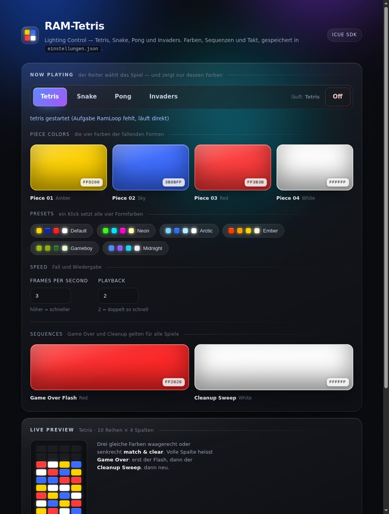
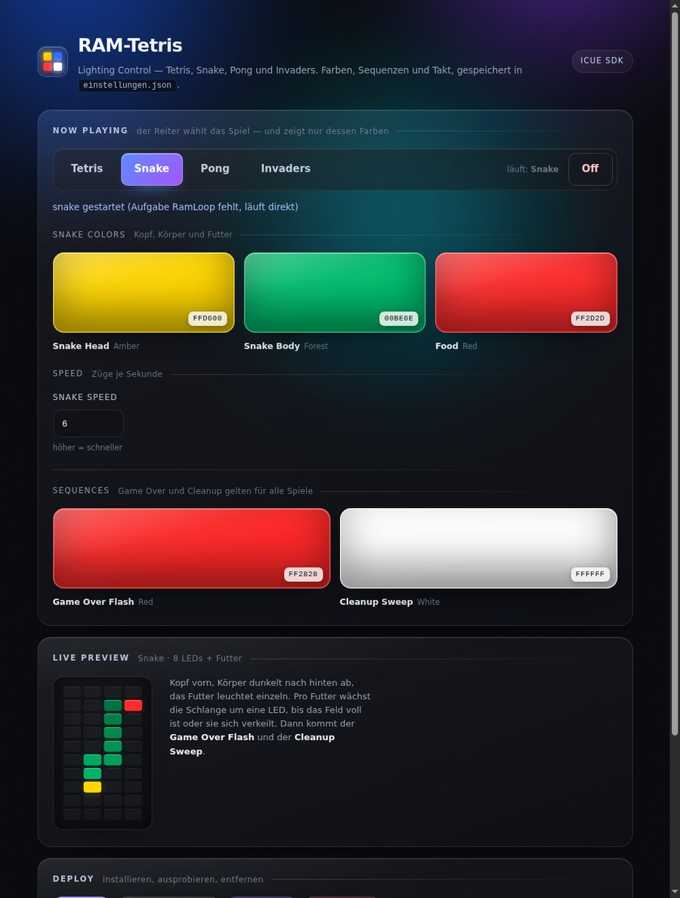
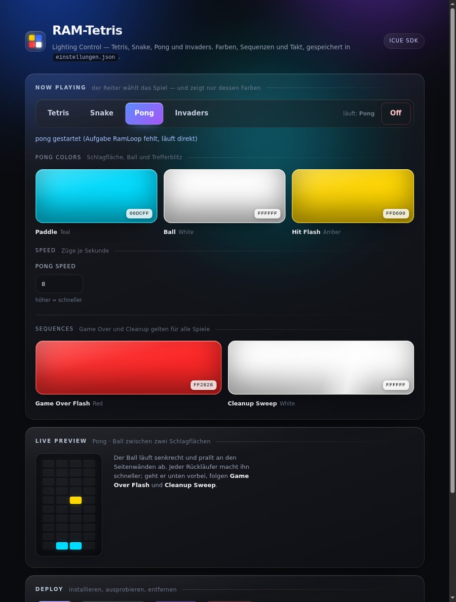
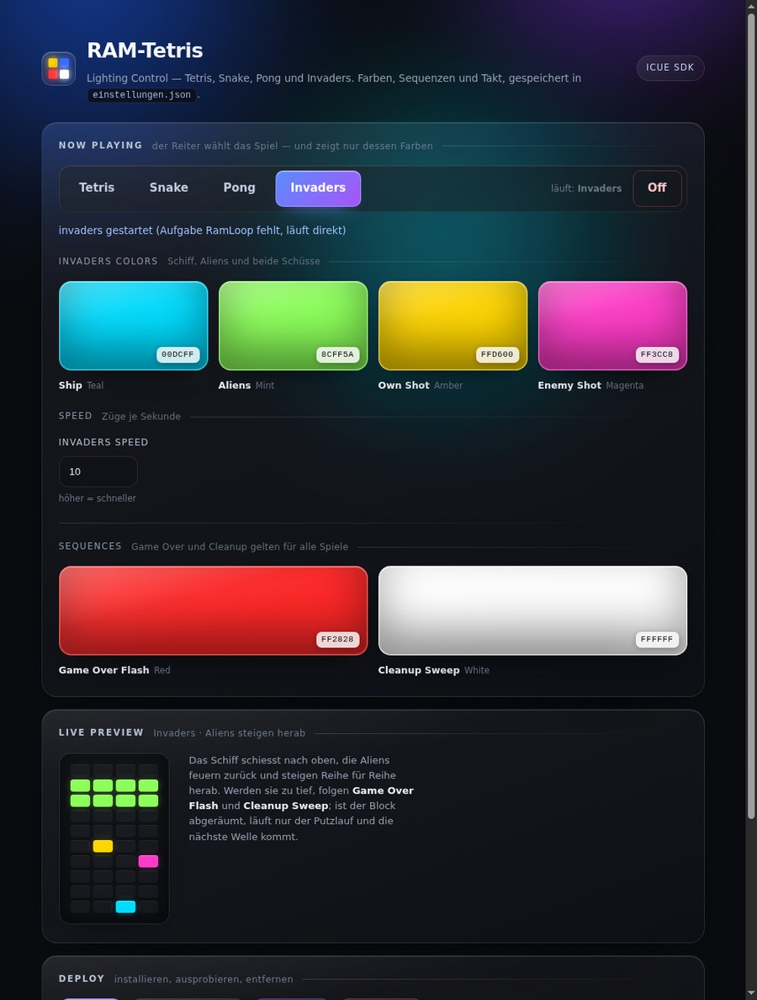

# RAM Games

Four games for the RGB LEDs on your memory modules — **Tetris**, **Snake**, **Pong** and
**Space Invaders** — drawn through the iCUE SDK that already ships with your Corsair installation.
Nothing to install, no extra driver, no OpenRGB.

*Vier Spiele für die RGB-LEDs der Arbeitsspeicher-Riegel. Deutsche Fassung weiter unten:
[Deutsch](#deutsch).*



**Full guide: [GUIDE.md](GUIDE.md)** — English on top, German below. Setup, colours, speed,
autostart, logs, troubleshooting, and how to add your own game.

## How it works

iCUE 5 has no command line, but it brings a **SDK DLL** that can address every single LED. iCUE
does the hardware work, the script only paints colours. The DLL usually arrives with a mainboard
vendor tool:

```
C:\Program Files\GIGABYTE\Control Center\Lib\MBStorage\iCUESDK.x64_2019.dll
C:\Program Files\Corsair\Corsair iCUE5 Software\iCUESDK.x64_2019.dll
```

It is called via `ctypes` — no compiler, no extra package. Blender's bundled Python works too.

The grid is **10 rows × 4 columns**: the geometry is read from `CorsairGetLedPositions`, not
guessed, so a different module count rearranges the field by itself.

## Quick start

```
python ram_tetris.py --probe                        # which device, which grid
python snake.py                                    # snake on the LEDs
python pong.py                                     # pong
python invaders.py                                 # space invaders
einstellungen.cmd                                 # settings page (double click, no port to remember)
```

Always only one game at a time — they write to the same 40 LEDs. The tab bar on the settings page
switches between them, and each tab shows only that game's colours:

| | |
|---|---|
|  |  |
|  |  |

## What is in the box

| File | Purpose |
|---|---|
| `icue_sdk.py` | the SDK, wrapped in `ctypes` |
| `ram_tetris.py` | Tetris, including record and replay |
| `snake.py` `pong.py` `invaders.py` | the other three games, each playing itself |
| `spielbasis.py` | shared base: display with reconnect, log, watchdog, game-over and cleanup sweep |
| `spielen.py` | supervisor: starts the game chosen in the settings and restarts it if it dies |
| `einstellungen.py` | the settings page (local web page, no extra packages) |
| `mache_icon.py` | builds `ram-tetris.ico` |
| `einstellungen.cmd` | double-click launcher for the settings page |
| `run.cmd` `run_hidden.vbs` | start the chosen game without a console window |
| `recorded/` | Tetris recordings for looping |

## Two things that cost time

**Never write LEDs through the async buffer.** `CorsairSetLedColorsBuffer` plus
`CorsairSetLedColorsFlushBufferAsync` frees memory while the flush is still reading it — the process
dies with `0xC0000005` and the LEDs simply freeze at the last frame, which looks like a hang, not a
crash. The synchronous `CorsairSetLedColors` costs a few milliseconds and is stable.

**A game that plays itself must be visible.** Dimming the body all the way down makes the whole
thing read as "off". Head at full brightness, body dimmed with a floor around 0.55, empty cells
exactly `(0,0,0)`.

More in [GUIDE.md](GUIDE.md) — including why an iCUE profile cannot hold a recorded animation
(there is no timeline), and what to do when iCUE takes control back.

## Licence

MIT. Model was the short "Mein RAM spielt Tetris, ganz ohne mich" by **Bastel Nerd**.

---
---

## Deutsch

Vier Spiele für die RGB-LEDs der Arbeitsspeicher-Riegel: **Tetris**, **Snake**, **Pong** und
**Space Invaders**. Sie laufen über die iCUE-SDK-DLL, die mit der Corsair-Software ohnehin auf dem
Rechner liegt — keine Installation, kein zusätzlicher Treiber, kein OpenRGB.

**Anleitung: [GUIDE.md](GUIDE.md)** — englisch oben, deutsch unten. Einrichtung, Farben, Tempo,
Autostart, Protokoll, Fehlersuche und wie man ein eigenes Spiel anschließt.

### Schnellstart

```
python ram_tetris.py --probe        # Gerät und Spielfeldgröße zeigen
python snake.py                     # Snake auf den Riegeln
python pong.py                      # Pong
python invaders.py                  # Space Invaders
einstellungen.cmd                   # Einstellungsseite (Doppelklick, kein Port zum Merken)
```

Immer nur ein Spiel gleichzeitig — alle schreiben auf dieselben 40 LEDs. Der Reiter oben auf der
Einstellungsseite schaltet um und zeigt dabei nur die Farben des gewählten Spiels.

### Der Trick

iCUE 5 hat keine Kommandozeile, aber eine **SDK-DLL**, die jede einzelne LED anspricht. iCUE macht
die Hardware-Arbeit, das Skript setzt nur Farben. Angesprochen wird sie über `ctypes` — ohne
Compiler und ohne Zusatzpaket; auch der Interpreter von Blender genügt.

Das Feld ist **10 Reihen × 4 Spalten**; die Geometrie kommt aus `CorsairGetLedPositions` und wird
nicht geraten.

### Zwei Dinge, die Zeit gekostet haben

**Niemals über den asynchronen Puffer schreiben.** `CorsairSetLedColorsBuffer` mit
`CorsairSetLedColorsFlushBufferAsync` gibt Speicher frei, während der Flush noch liest — der
Prozess stirbt mit `0xC0000005` und die LEDs bleiben beim letzten Bild stehen. Von außen sieht das
wie ein Hänger aus, nicht wie ein Absturz. Der synchrone Aufruf kostet Millisekunden und ist stabil.

**Ein selbstspielendes Spiel muss sichtbar sein.** Wird der Körper zu stark abgedunkelt, wirkt alles
wie „aus". Kopf in voller Helligkeit, Körper mit Untergrenze um 0,55, leere Zellen exakt `(0,0,0)`.

Mehr in [GUIDE.md](GUIDE.md) — auch warum ein iCUE-Profil keine aufgezeichnete Animation halten kann
(es gibt keinen Zeitstrahl) und was zu tun ist, wenn iCUE die Kontrolle zurückholt.

### Lizenz

MIT. Vorbild ist der Short „Mein RAM spielt Tetris, ganz ohne mich" von **Bastel Nerd**.
